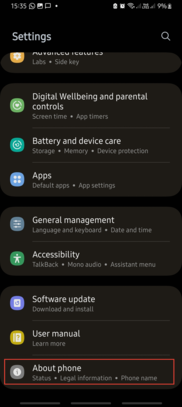
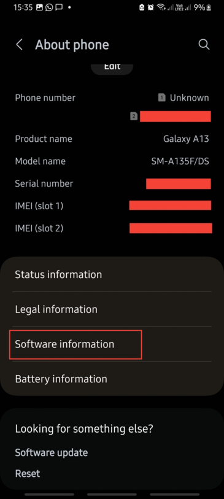
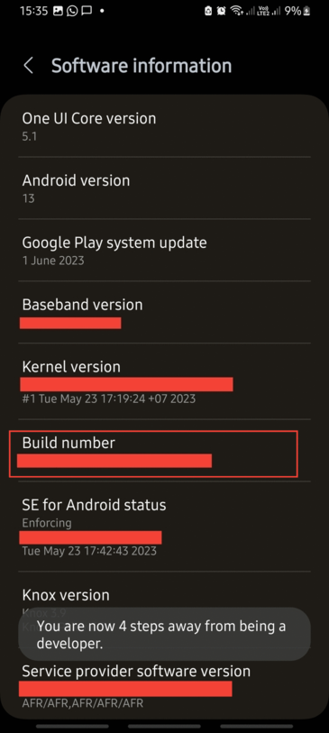
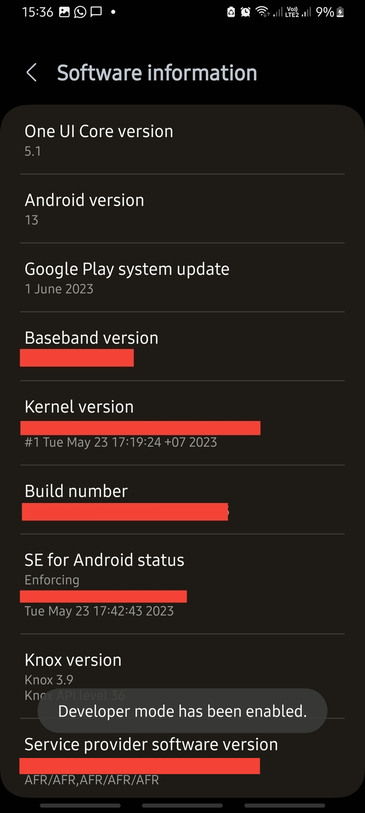
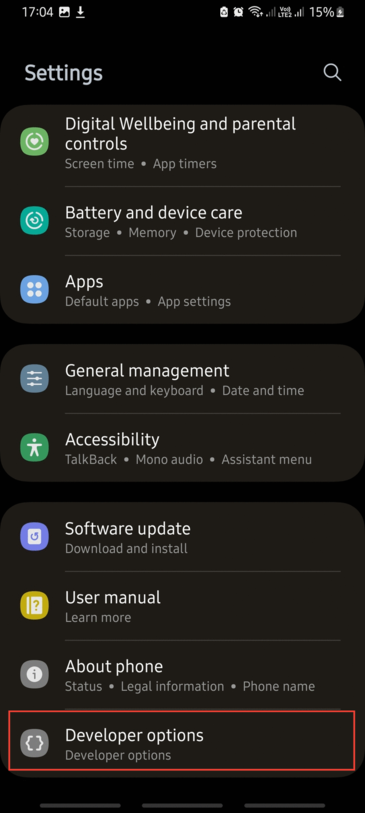
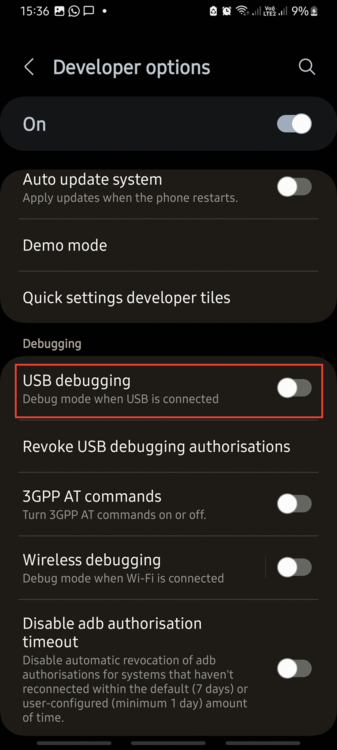

# Developer Mode Enabling

  - Open the Settings app on your Android device. You can usually find it on the home screen or in the app drawer. Scroll down in the settings menu and look for the "About phone" option. Tap on it to access more information about your device.
  
  

  - In the "About phone" section, find and tap on "Software information". This section contains details about your device's software. In the "Software information" section, look for "Build number". Tap on this entry multiple times (usually 7 times) quickly. You will see a message indicating that you are a few steps away from enabling the developer mode.
  
  
  
  
  - Continue tapping the "Build number" until you see a message that says "Developer mode has been enabled". This means that you have successfully enabled the developer mode on your device.

  
  
  - Now, go back to the main settings menu, and you should see a new entry called "Developer options". Tap on it to access more settings. In the "Developer options" menu, scroll down until you find the "USB debugging" toggle switch. Enable it by toggling the switch to the right. A confirmation dialog will appear; tap OK to proceed.
  
  
  
  
  - After enabling USB debugging, you may see a warning message about the potential risks of enabling this feature. Read the warning and tap OK to confirm.
  
Congratulations! You have successfully enabled developer options and USB debugging on your Android device. USB debugging allows your device to communicate with a computer and is essential for activities like app development. Remember to use USB debugging responsibly and disable it when not needed to enhance the security of your device.